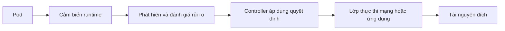

# Zero Trust và mô hình đe dọa cho di chuyển ngang

## Từ vị trí trong mạng đến quyết định truy cập

Một hệ thống có thể mở payment cho checkout vì checkout cần tính tiền. Nếu mạng cho phép mọi pod kết nối tới payment, một pod recommendation bị xâm nhập cũng có cơ hội thử kết nối. **Di chuyển ngang** mô tả việc đối thủ tiến sang hệ thống khác sau khi đã có chỗ đứng. **Blast radius** là phạm vi bị ảnh hưởng hoặc tiếp cận được dưới một giả định cụ thể.

Zero Trust bảo vệ tài nguyên dựa trên yêu cầu truy cập, danh tính và ngữ cảnh thay vì cấp đặc quyền mặc nhiên theo vị trí mạng. Bảy nguyên tắc ở mục 2.1 của NIST SP 800-207 có thể học qua các câu hỏi sau.

| Điều phải xét | Câu hỏi cho Online Boutique |
|---|---|
| Xác định tài nguyên | Ai có thể truy cập payment, dữ liệu giỏ hàng, Kubernetes API và kho log? |
| Bảo vệ liên lạc ở mọi vị trí | Lưu lượng nội bộ được bảo vệ và xác thực thế nào? |
| Cấp quyền theo phiên | Được truy cập checkout có mở quyền tới payment luôn không? |
| Chính sách theo ngữ cảnh | Danh tính, quyền và tình trạng runtime nào ảnh hưởng quyết định? |
| Theo dõi tình trạng tài sản | Pod có đang chạy image và cấu hình đã kiểm kê không? |
| Xác thực và phân quyền trước truy cập | Chủ thể là ai và được thực hiện thao tác nào? |
| Thu thập dữ liệu để cải thiện bảo vệ | Sự kiện nào đã dẫn đến thay đổi chính sách và kết quả ra sao? |

Nguồn đọc mục 2–3. [R1 NIST SP 800-207](../TaiLieu_Tuan1_Tuan2/PDF/R1-NIST-SP-800-207.pdf)

## Xác thực, phân quyền và thực thi

**Xác thực** trả lời “ai đang yêu cầu?”. **Phân quyền** trả lời “chủ thể đó được làm gì?”. mTLS có thể giúp hai đầu xác thực lẫn nhau và bảo vệ kênh truyền. Quyết định “chỉ checkout được gọi thao tác thanh toán” cần một cơ chế phân quyền thích hợp ở ứng dụng hoặc lớp proxy.

Trong mô hình NIST, **Policy Engine (PE)** quyết định, **Policy Administrator (PA)** điều phối thi hành, **Policy Enforcement Point (PEP)** kiểm soát truy cập. PE và PA tạo thành **Policy Decision Point (PDP)**. Ví dụ thiết kế cho đề tài:

Cảm biến cung cấp dữ liệu đầu vào. Module quyết định xét mức độ nghi ngờ và phạm vi phản ứng. Controller gửi cấu hình. CNI hoặc proxy tương ứng thực thi. Muốn chứng minh chính sách có hiệu lực, đo kết quả ở đường truy cập sau thay đổi. [R1 NIST Zero Trust Architecture](https://doi.org/10.6028/NIST.SP.800-207)

## Mô hình đe dọa đề xuất

Mô hình đe dọa ghi lại giả định về tài sản, đối thủ và phạm vi để người khác biết kết quả áp dụng được đến đâu.

| Thành phần | Giả định cho lần chạy đầu |
|---|---|
| Tài sản | API payment, dữ liệu giả lập, danh tính của workload, API server, log telemetry |
| Ranh giới | Người dùng ↔ frontend, pod ↔ pod, pod ↔ API server, cảm biến ↔ kho dữ liệu |
| Chỗ đứng | Đối thủ đã thực thi được lệnh với quyền container trong pod giả lập |
| Năng lực | Tạo kết nối từ pod, chạy binary có sẵn, truy cập file mà tiến trình có quyền |
| Đích thử nghiệm | Thiết lập kết nối từ nguồn ngoài luồng tới payment, hoặc thực hiện một thao tác lab ở đích |
| Defender | Có quyền điều phối cảm biến và áp dụng policy trong cluster thử nghiệm |
| Giả định tin cậy | Kernel node, control plane và nơi lưu bằng chứng chưa bị đối thủ kiểm soát |
| Ngoài phạm vi | Chiếm kernel, thoát container, chiếm control plane và khai thác zero-day |

Nếu dùng `kubectl exec` để tạo sự kiện, ghi rõ đây là **cơ chế mô phỏng năng lực có sẵn**. Nếu dùng pod kiểm thử thay cho recommendation thật, ghi khác biệt về ServiceAccount, label và quyền mạng. Hai nguồn có thể bị áp dụng policy khác nhau.

## Tách hành vi, bằng chứng và kết quả

MITRE ATT&CK dùng **tactic** để chỉ mục tiêu của đối thủ và **technique** để mô tả cách thực hiện. TA0008 là tactic Lateral Movement.

| Bước quan sát | Bằng chứng nên dùng | Cách gắn nhãn |
|---|---|---|
| Liên hệ nhiều cổng dịch vụ nội bộ | Nhiều lần thử kết nối, nhiều đích, thời gian tập trung | Discovery, T1046 nếu hành vi là dò dịch vụ |
| Chạy shell trong container | Exec event, binary, tiến trình cha | Execution, T1059.004 khi dùng Unix shell |
| Truy cập file thông tin xác thực | File event, đường dẫn, kết quả thao tác | Credential Access, xem T1552.001 khi phù hợp |
| Dùng token bị lấy để truy cập hệ thống khác | Yêu cầu ở phía đích kèm danh tính và kết quả | Cân nhắc T1550.001 theo hành vi thực tế |
| Gọi payment ngoài luồng qua gRPC | Kết nối, nguồn và log kết quả ở đích | Ghi vi phạm chính sách; xác định kỹ thuật ATT&CK khi đủ bằng chứng |

Nguồn đối chiếu. [R2 TA0008](../TaiLieu_Tuan1_Tuan2/PDF/R2-MITRE-ATTACK-TA0008.pdf), [T1046](https://attack.mitre.org/techniques/T1046/), [T1059.004](https://attack.mitre.org/techniques/T1059/004/), [T1552.001](https://attack.mitre.org/techniques/T1552/001/), [T1550.001](https://attack.mitre.org/techniques/T1550/001/).

**Ví dụ tiêu chí thành công.** Trong bài thử phân đoạn, thành công của nguồn thử là mở được TCP tới payment trong 3 giây. Với bài thử phân quyền ứng dụng, thành công là lời gọi lab được đích chấp nhận và có bản ghi đối chiếu. Ghi hai kết quả ở hai cột khác nhau.

## Tự kiểm tra

1. **Một dòng log cho biết pod chạy shell, cần thêm gì để xác nhận di chuyển ngang?** Cần chứng cứ đối thủ tiến sang tài nguyên khác, cùng cách truy cập và kết quả phù hợp với kịch bản.
2. **Token của Pod có quyền gì?** Kiểm tra danh tính, audience, thời hạn và quyền được cấp trong API đích.
3. **Tại sao vẫn cần xác thực khi dịch vụ nằm trong mạng riêng?** Vì vị trí mạng chưa chứng minh danh tính hay quyền của caller.

Tiếp theo [bài 3](03-bao-mat-kubernetes-networkpolicy.md).

