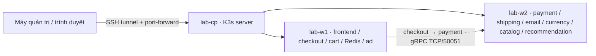

# Testbed Online Boutique trên ba VM

## Kiến trúc được chọn

Dùng **K3s với một server và hai agent**, cùng Ubuntu Server 24.04 LTS amd64, **mỗi VM 2 vCPU, 4 GB RAM và 40 GB SSD** làm cấu hình đề xuất. Ba VM đủ để kiểm chứng chức năng và chạy benchmark tải nhẹ sau khi đo tài nguyên. Khả năng chạy thêm mesh và collector phụ thuộc CPU thực, RAM khả dụng và tải. Nếu đặt cả ba VM trên cùng máy vật lý, kết quả cross-node phản ánh ba kernel VM và mạng ảo cùng host. Ghi rõ cấu hình này trong luận văn. Nếu có quyền chọn cấu hình máy chủ, 16 GB RAM vật lý có ít dư địa sau khi cấp 12 GB cho VM. 24–32 GB thoải mái hơn trên máy còn chạy Windows, IDE và trình duyệt. Đây là gợi ý dung lượng, không phải điều kiện cài đặt của K3s.

| VM | IP riêng mẫu | Vai trò và thành phần |
|---|---|---|
| lab-cp | 192.168.141.142 | API server, scheduler, controller, datastore SQLite mặc định. Taint để dành tài nguyên cho control plane. |
| lab-w1 | 192.168.141.143 | frontend, checkoutservice, cartservice, redis-cart, adservice. Loadgenerator gắn w1 khi bật. |
| lab-w2 | 192.168.141.144 | paymentservice, shippingservice, emailservice, currencyservice, productcatalogservice, recommendationservice. |
| Máy quản trị | Host hoặc truy cập SSH tới lab-cp | Trình duyệt, thu log dài hạn, phân tích. Có thể đặt bộ sinh tải HTTP ngoài cluster nếu định nghĩa và đo riêng đường vào. |



**Vì sao chọn K3s.** K3s cung cấp containerd, Flannel, CoreDNS, metrics-server và controller NetworkPolicy tích hợp, phù hợp khi lab cần dành phần lớn thời gian cho ứng dụng và đo bảo mật. Kubeadm phù hợp nếu yêu cầu của môn học là tự vận hành container runtime, CNI và kiến trúc upstream từng bước. Phương án đó cần chọn và kiểm chứng lớp thực thi NetworkPolicy riêng. Tài liệu chính thức ghi mức nền K3s server 2 core/2 GB, agent 1 core/512 MB, chưa gồm workload. Một server SQLite là một điểm lỗi của control plane. Hai agent cho phép đo cross-node, còn controller và các dịch vụ chỉ có một replica có thể gián đoạn ngay khi node tương ứng lỗi. [K3s Requirements](https://docs.k3s.io/installation/requirements), [K3s Networking Services](https://docs.k3s.io/networking/networking-services), [K3s Datastore](https://docs.k3s.io/datastore), [Installing kubeadm](https://kubernetes.io/docs/setup/production-environment/tools/kubeadm/install-kubeadm/)

## Tính tài nguyên từ R8

Tính từ `release/kubernetes-manifests.yaml` trong tag v0.10.7, mỗi Deployment một replica. Các số dưới đây gồm container ứng dụng, chưa gồm OS, daemon hệ thống, proxy, agent hay pod kiểm thử.

| Placement | Pod chạy baseline | CPU requests | RAM requests |
|---|---:|---:|---:|
| w1, loadgenerator tắt | 5 | 670m | 572 MiB |
| w2 | 6 | 600m | 540 MiB |
| Tổng baseline | 11 | 1.270m | 1.112 MiB |
| Tổng khi bật một loadgenerator trên w1 | 12 | 1.570m | 1.368 MiB |

`1000m` bằng một lõi CPU theo cách khai báo tài nguyên Kubernetes. Scheduler xét **requests** theo từng node và **Allocatable**. RAM thực tế phụ thuộc tải và có thể tăng đến giới hạn của container. Đừng cộng RAM master vào ngân sách placement của hai worker. Theo dõi số đo sau mỗi tầng. Bố trí này cố định workload vào một worker bằng `nodeSelector`; nếu worker dừng, Pod gắn với worker đó không tự chuyển sang worker khác. Đây là chủ ý để giữ vị trí ổn định khi đo. [R8 release v0.10.7](https://github.com/GoogleCloudPlatform/microservices-demo/releases/tag/v0.10.7), [Kubernetes Resource Management](https://kubernetes.io/docs/concepts/configuration/manage-resources-containers/), [Node selection](https://kubernetes.io/docs/concepts/scheduling-eviction/assign-pod-node/)

## 1 Chuẩn bị máy ảo và mạng

1. Đặt hostname và IP riêng cố định khác nhau. Ba VM phải ở cùng mạng ảo riêng. Adapter NAT hoặc mạng có route riêng cung cấp DNS và Internet cho tải image. Với VM clone, kiểm tra MAC và machine-id khác nhau.
2. Kiểm tra từ mỗi VM có đường tới hai VM còn lại. Nếu có hai NIC hoặc địa chỉ tự chọn sai, cấu hình `node-ip` và dùng thêm `flannel-iface` trỏ vào đúng NIC riêng trong mỗi file khi cần. Dải Pod và Service phải tránh trùng subnet máy thật/VPN. Với mặc định K3s, kiểm tra xung đột với `10.42.0.0/16` và `10.43.0.0/16` trước cài.
3. Allow TCP/6443 từ worker và máy quản trị tin cậy tới server. Với Flannel VXLAN, allow UDP/8472 giữa các node trong mạng riêng. Cho phép TCP/10250 giữa node nếu dùng metrics-server. SSH chỉ từ mạng quản trị. Kiểm tra DNS, HTTPS ra ngoài và đồng bộ giờ. [K3s networking requirements](https://docs.k3s.io/installation/requirements)
4. Cấu hình lab này dùng RAM cố định. Nếu VM bật swap và kubelet không hỗ trợ theo cấu hình của bạn, tắt swap và cấu hình để không bật lại khi reboot. Kiểm tra trên mỗi VM trước khi tạo snapshot sạch.

```bash
hostnamectl
ip -br addr
ip route
free -h
lsblk
swapon --show
timedatectl
uname -r
test -r /sys/kernel/btf/vmlinux && echo 'Kernel BTF readable'
```

## 2 Cài K3s

Sao chép thư mục tài liệu sang VM quản trị hoặc server. Sửa IP trong ba file YAML cho đúng mạng. Sao chép file của từng node tới VM tương ứng. Lệnh dưới đây dùng bản K3s cụ thể đã có trong release notes để có thể tái lập. Khi bắt đầu thực nghiệm chính thức, chọn bản vá còn được hỗ trợ, kiểm tra tương thích với phiên bản Istio định dùng và đồng nhất tag trên cả ba máy. [K3s v1.35 release notes](https://docs.k3s.io/release-notes/v1.35.X), [Istio supported releases](https://istio.io/latest/docs/releases/supported-releases/)

**Trên lab-cp (.142)**, SSH vào máy `manager` và chạy `cd ~/Testbed_Online_Boutique`. Kiểm tra `hostname` ra `manager` trước khi tiếp tục.

```bash
sudo install -D -m 600 cluster/lab-cp.yaml /etc/rancher/k3s/config.yaml
sudo sh -c 'umask 077; test -s /etc/rancher/k3s/agent-join-secret || openssl rand -hex 32 > /etc/rancher/k3s/agent-join-secret'
curl -fL https://get.k3s.io -o k3s-install.sh
sudo env INSTALL_K3S_VERSION='v1.35.9+k3s1' sh ./k3s-install.sh server
sudo systemctl is-active k3s
sudo k3s kubectl get nodes -o wide
```

K3s mặc định tự chạy một agent ở server, nên file cấu hình dùng taint để Pod ứng dụng không được đặt ở đó. File còn tắt Traefik, ServiceLB và local-storage cho lab truy cập qua port-forward. CoreDNS, metrics-server và NetworkPolicy controller được giữ. Nếu triển khai thành phần đòi PVC sau này, cấu hình storage riêng. [K3s server options](https://docs.k3s.io/cli/server), [K3s config file](https://docs.k3s.io/installation/configuration)

**Trên từng worker**, mở một cửa sổ SSH mới từ máy quản trị. Kết nối `sonth32@192.168.141.143` cho worker 1 và `sonth32@192.168.141.144` cho worker 2. Chạy `cd ~/Testbed_Online_Boutique` trên từng máy. Kiểm tra `hostname` ra `worker-1` hoặc `worker-2` rồi dùng đúng file cấu hình. Chạy lệnh cài agent trên .142 sẽ ghi đè cấu hình server và có thể gây lỗi cổng 6444. Cấu hình tạo secret riêng cho agent để tham gia cụm. Sau khi server khởi động, token dạng an toàn có kèm CA hash nằm tại `/var/lib/rancher/k3s/server/agent-token`. Chuyển nội dung qua kênh quản trị tin cậy vào file chỉ root đọc trên từng worker. Đừng đưa token hoặc kubeconfig vào thư mục dữ liệu thí nghiệm.

```bash
sudo install -D -m 600 cluster/lab-w1.yaml /etc/rancher/k3s/config.yaml
sudo test -e /etc/rancher/k3s/agent-token || sudo install -m 600 /dev/null /etc/rancher/k3s/agent-token
sudoedit /etc/rancher/k3s/agent-token
sudo test -s /etc/rancher/k3s/agent-token
curl -fL https://get.k3s.io -o k3s-install.sh
sudo env INSTALL_K3S_VERSION='v1.35.9+k3s1' sh ./k3s-install.sh agent
sudo systemctl is-active k3s-agent
```

Các bước này dành cho cài mới. Nếu cần kiểm tra lại lần cài, giữ file token đã thiết lập. Từ lab-cp, xác nhận ba node Ready và IP/label khớp. Khi agent không join, xem `sudo journalctl -u k3s-agent -n 100 --no-pager` trên worker và thử đường TCP/6443. [K3s Quick Start](https://docs.k3s.io/quick-start), [K3s agent flags](https://docs.k3s.io/cli/agent), [K3s token](https://docs.k3s.io/cli/token)

```bash
sudo k3s kubectl get nodes -o wide --show-labels
sudo k3s kubectl get pods -A -o wide
```

## 3 Xác nhận DNS, mạng cross-node và NetworkPolicy

Thực hiện từ lab-cp, ở thư mục chứa `checks/`. Bộ thử tạo HTTP đích trên w2 và hai client trên w1. Nó xác minh đường mạng trước khi triển khai ứng dụng. Chạy theo thứ tự thủ công để quan sát mã thoát của client bị chặn.

```bash
sudo k3s kubectl apply -f checks/cross-node.yaml
sudo k3s kubectl -n policy-lab wait --for=condition=Ready pod --all --timeout=180s
sudo k3s kubectl -n policy-lab get pods -o wide
sudo k3s kubectl -n policy-lab exec allowed -- nslookup lab-http.policy-lab.svc.cluster.local
sudo k3s kubectl -n policy-lab exec allowed -- wget -T 3 -qO- http://lab-http:8080/
sudo k3s kubectl -n policy-lab exec blocked -- wget -T 3 -qO- http://lab-http:8080/
sudo k3s kubectl apply -f checks/allow-one.yaml
sudo k3s kubectl -n policy-lab exec allowed -- wget -T 3 -qO- http://lab-http:8080/
sudo k3s kubectl -n policy-lab exec blocked -- wget -T 3 -qO- http://lab-http:8080/
```

Trước policy, cả hai in `boutique-network-ok`. Sau khi hội tụ, `allowed` tiếp tục in thông báo, còn `blocked` phải lỗi kết nối, có thể báo `Connection refused` hoặc timeout tùy cách thực thi. Dùng kết nối mới mỗi lần. Nếu thử lại từ đầu, xóa policy của bài thử trước khi chạy bước đo baseline. Có thể giữ namespace này riêng cho kiểm chứng và loại khỏi bộ dữ liệu baseline hoặc dọn sau khi ghi kết quả. [Kubernetes Network Policies](https://kubernetes.io/docs/concepts/services-networking/network-policies/)

## 4 Chạy Online Boutique

Overlay trong `boutique/` dùng bản upstream đi kèm, nạp vào namespace `boutique`, bỏ đối tượng `frontend-external`, gắn placement như bảng và đặt loadgenerator bằng 0. Dùng overlay ngay từ lần triển khai đầu. Nếu trước đó đã tạo Service LoadBalancer bằng manifest upstream, kiểm tra và xóa riêng Service cũ sau khi xác định đã chuyển sang port-forward. `apply -k` không tự dọn đối tượng bị bỏ khỏi overlay.

```bash
sudo k3s kubectl create namespace boutique --dry-run=client -o yaml \
  | sudo k3s kubectl apply -f -
sudo k3s kubectl kustomize boutique > boutique-rendered.yaml
sudo k3s kubectl apply --dry-run=server -k boutique
sudo k3s kubectl apply -k boutique
sudo k3s kubectl -n boutique get deployments,pods,svc,endpointslice -o wide
sudo k3s kubectl -n boutique rollout status deployment/frontend --timeout=300s
sudo k3s kubectl -n boutique rollout status deployment/paymentservice --timeout=300s
sudo k3s kubectl -n boutique get pods -o wide
sudo k3s kubectl -n boutique port-forward svc/frontend 8080:80
```

Giữ terminal port-forward trên lab-cp. Nếu trình duyệt chạy trên host, mở thêm tunnel từ host qua SSH (đổi tên user). Dùng `http://localhost:8080`. Port-forward hữu ích để kiểm tra thao tác, còn benchmark chính thức cần đường sinh tải được ghi và giữ cố định.

```bash
ssh -N -L 8080:127.0.0.1:8080 USER@192.168.141.142
```

**Tiêu chí đạt:** 11 Pod ứng dụng Ready và đúng node, loadgenerator 0/0; mở trang, xem sản phẩm, thêm giỏ và checkout giả lập thành công; không có restart tăng trong thời gian quan sát; Service payment có endpoint trên w2, checkout nằm w1. Ghi các deployment/lỗi backend nếu frontend mở được mà checkout lỗi. Giữ phiên bản v0.10.7 và xuất imageID thực tế mỗi lần chạy, nhất là `redis:alpine` dùng tag có thể thay đổi. Để tái lập qua thời gian, pin digest đã kiểm thử qua overlay và lưu manifest kết quả. [R8 repo v0.10.7](https://github.com/GoogleCloudPlatform/microservices-demo/tree/v0.10.7)

## 5 Mở rộng từng pha và đo

| Pha | Thành phần bật | Mục đạt |
|---|---|---|
| A | Online Boutique | Hoàn tất kiểm tra chức năng; chụp tài nguyên idle và dưới tải nhẹ. |
| B | Cùng ứng dụng + Tetragon, hoặc Falco nếu ưu tiên rule | Kiểm chứng một sự kiện ở mỗi worker; ghi node, Pod, container, thời gian, tình trạng drop. |
| C | Cùng collector + Istio có sidecar ở workload cần đo | Đo chênh lệch CPU/RAM, p95 checkout và throughput trước khi chặn. |
| D | Thêm policy theo kịch bản | Từ chối caller ngoài quyền và xác nhận luồng checkout vẫn thành công. |

Tetragon cần các tính năng kernel phù hợp, gồm BTF cho CO-RE. Cài chart phiên bản cố định khi thực hiện pha B. Verify agent trên **cả hai worker**, bật từng tracing policy, lưu NDJSON và metadata ra máy quản trị. Process event có sẵn khi đường thu hoạt động; quan sát network nội bộ cần policy phù hợp. Bài network quickstart tập trung vào egress ngoài cluster nên kiểm tra bộ lọc trước khi dùng. [Tetragon deploy](https://tetragon.io/docs/installation/kubernetes/), [Tetragon BTF](https://tetragon.io/docs/installation/faq/), [Network monitoring](https://tetragon.io/docs/getting-started/network/)

Nếu kích hoạt loadgenerator trong cluster, start một replica và ghi cấu hình tải. Apply lại overlay hiện tại sẽ đưa replica về 0. Nếu chạy Istio, ghi rõ cách injection, số sidecar và proxy requests của phiên bản cài. Với 4 GB mỗi worker, thêm mesh sau collector khi các phép thử trước đã ổn. Cấu hình ngưỡng lab đề xuất: còn khoảng 700–1.000 MiB RAM khả dụng lúc tải ổn định, không có `MemoryPressure`, OOM hay vòng lặp restart. Đây là ngưỡng vận hành lựa chọn cho thí nghiệm. Nếu vượt giới hạn, giảm mức tải/độ phủ telemetry hoặc tăng RAM, rồi đo lại với cấu hình đã ghi. Đặt kho log/Prometheus dung lượng lớn ngoài cluster nếu cần giữ phép đo gọn. [Istio performance](https://istio.io/latest/docs/ops/deployment/performance-and-scalability/)

```bash
sudo k3s kubectl top nodes
sudo k3s kubectl top pods -A --containers
sudo k3s kubectl describe node lab-w1
sudo k3s kubectl describe node lab-w2
sudo k3s kubectl -n boutique get pods -o json > pods.json
sudo k3s kubectl -n boutique get svc,endpointslice -o json > service-endpoints.json
```

`top` dùng metrics-server và có thể chưa có dữ liệu ngay sau cài. `describe node` có thông tin Allocatable, requests theo node, conditions và events. Theo dõi `free -h` trên VM, dung lượng đĩa, độ trễ/CPU steal nếu host chạy nhiều VM, cùng số liệu của agent. Khi định lượng overhead, giữ cố định load, warm-up, topology, máy host và phiên bản. Báo ít nhất baseline, collector, mesh và policy riêng.

## Chẩn đoán nhanh

| Dấu hiệu | Việc kiểm tra đầu tiên |
|---|---|
| Worker không Ready | Agent log, TCP/6443, token, hostname/IP, đồng hồ. |
| Pod cùng node thông được, khác node không | UDP/8472, NIC Flannel, MTU và route giữa VM. |
| ImagePullBackOff | Registry DNS/HTTPS, kiến trúc amd64, image/ref và Pod events. |
| Pod Pending | `describe pod` để xem nodeSelector, label, taint, tài nguyên. |
| DNS lỗi trên cả hai worker | CoreDNS, EndpointSlice của DNS Service và đường mạng tới các endpoint. |
| checkout không gọi được payment | Service endpoint/cổng, node placement, policy mạng, log checkout/payment, rồi mTLS/authz nếu đã bật. |
| Thu được event một worker | Placement DaemonSet và phạm vi nguồn thu tại từng worker. |

Kèm theo [học liệu triển khai ứng dụng](../HocLieu_Tuan1_Tuan2/04-testbed-online-boutique.md) và [học liệu Istio](../HocLieu_Tuan3/10-istio-policy-enforcement.md). Các file trong thư mục này là cấu hình đề xuất. Xác nhận lại trên ba VM trước khi sử dụng làm kết quả luận văn.

Để cài Prometheus/Grafana và chạy tải bình thường, xem [bước 5 — giám sát và baseline S0](monitoring/README.md).

GĐ3 tiếp tục với [kế hoạch và script thu runtime telemetry](telemetry/README.md). Bộ script cài Tetragon lên hai worker, kiểm tra hook TCP và thu lượt S0 với Locust cùng dashboard Grafana.
